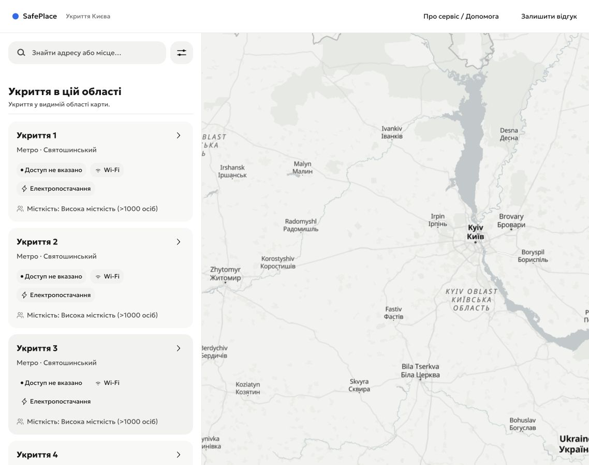

# Analyst dataset audit — 2026-11-25

Audited commit: `230c3a8`, branch `feat/frontend-api-integration`.
Local Vite :4173, FastAPI :8000, PostgreSQL `safeplace_analyst_local`.
This is an audit, not a claim that the findings below have been fixed.

## Automated and API checks

- `npm run check`: ESLint, TypeScript, production build, 48 tests and Prettier pass.
- Build retains the large MapLibre chunk warning: 1086.44 kB (298.85 kB gzip),
  separate worker 520.10 kB. Build success is not a Lighthouse result.
- GET /places: 2806 records, 1,741,652 response bytes. Five sequential local
  reads: 176.1, 164.3, 172.8, 125.3, 142.5 ms; median 164.3 ms.
  These are local Python client wall times, not internet latency or UI render time.
- GET /filters and /places/1: 200; nonexistent /places/99999999: 404.
- Search `метро`, limit 100: 42 matches. Search also matches addresses such as
  Метрологічна, so this count must not be interpreted as 42 metro stations.
- Controlled HTTP-client checks: 429 remains ApiError(429) with no automatic
  retry; network failure rejects; pending search cancels with AbortError.
  These checks use injected fetch responses, not a live rate-limit load test.

## Browser checks

- Real map tiles, custom markers and clusters render. Clicking cluster 2792
  expands into smaller groups (including 868, 750 and 570).
- Shelter 1 detail loading resolves to real address, facilities and hours.
- Search results load; Escape closes search and clears the input.
- Mobile menu opens/closes and switches EN/UA.
- Wi-Fi filter shows 403 matches and applying it renders 403 cards.
- No document horizontal overflow at sampled widths: UA 320/390/1440,
  EN 320/768. Screenshots capture UA 390 and 1440 after recovery.
- No console errors observed before the deliberate API outage.
- Stopped our local API, reloaded UI: explicit connection/load error with Retry.
  Restarted the same API/DB; Retry restored all 2806 cards without a page reload.
  API remains running after the test. Outage errors are expected in dev logs.

## Findings and next work

1. **High priority — bound list rendering.** Initial list mounts 2806 cards and
   the page contains 32,621 DOM elements. App.tsx maps every record. Add windowing
   or deliberate incremental rendering, retaining keyboard access and ensuring
   all results remain reachable. Map clustering does not optimize this list.
2. **High priority — distinguish search results.** Search adapter displays name
   plus type, omitting address when a name exists. Real results repeat
   `Житловий будинок / підвал`; users cannot distinguish locations. Show the
   returned address in each suggestion. Backend search currently covers address
   and type, not name; searching by building name needs a separate decision.
3. **Backend contract — names and access.** All 2806 catalog DTOs omit `name`;
   card titles fall back to an ID. Access is unspecified; open-to-all and 24/7
   filters show zero. Agree on fields/semantics; do not infer safety/access from
   opening-hours strings. Search DTOs already contain names.
4. **Data localization.** EN UI strings switch correctly, but imported district,
   capacity and hours often contain only uk. They visibly fall back to Ukrainian.
   Decide whether to translate controlled categories locally or enrich data;
   avoid treating free-form source text as a missing UI dictionary key.
5. **Payload and broad searches.** Full catalog is ~1.74 MB. Search client fetches
   all pages sequentially before displaying results, and search panel maps all
   results. Measure on a throttled device, then introduce bounded display/API
   pagination where warranted without silently dropping matches.

## Not certified by this audit

- Lighthouse/Core Web Vitals, animation frame timing, reduced-motion behavior
  and full visual comparison against updated Figma.
- Browser throttling and a real HTTP 429 form flow; only transport-level checks
  cover those errors. No feedback/suggestion rows were submitted in this audit.
- Docker deployment: docker executable is absent. Host Python 3.13/PostgreSQL 14
  differs from declared Python 3.14/PostgreSQL 17 containers. Production hosting,
  proxy/static configuration and container startup remain to be verified.
- Source coordinate/address correctness. Import acceptance is not geographic QA.

