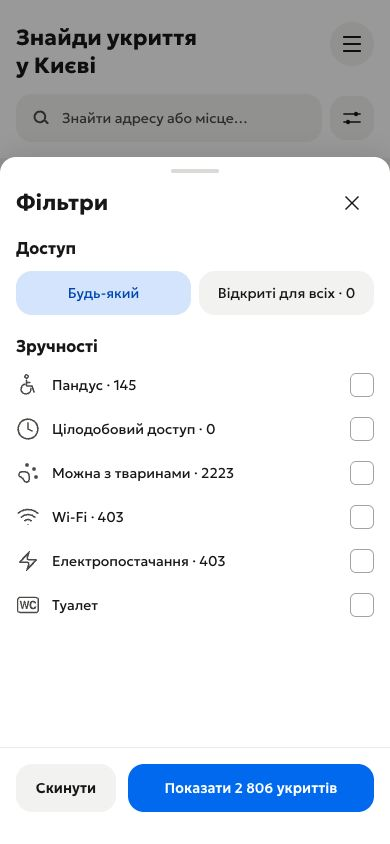

# Performance and motion follow-up — 2026-11-26

Production Vite preview on :4174, real local API :8000 and 2806 analyst records.
Lighthouse 12.8.2, headless Chrome, default simulated mobile throttling;
 desktop run uses --preset=desktop. Mobile runs were captured November 25;
 desktop and closing-motion verification completed November 26.

## Changes

- FastAPI GZipMiddleware compresses responses >=1000 bytes, level 5, for clients
  accepting gzip. No DTO changes. Catalog transfers 81,093 bytes instead of
  1,741,652 (95.3% smaller). Decoded JSON equality verified through the preview
  proxy; both contain all 2806 records. Vary: Accept-Encoding verified. Small
  /health response remains uncompressed with status 200.
- Memoize GeoJSON serialization by shelters/selection, avoiding rebuilding it
  on unrelated map renders while preserving equality across translated data.
- Format cluster counts consistently in visible text and accessible names.
  Lighthouse label-content-name-mismatch now passes (previously 2792 vs 2 792).

## Lighthouse results

| Run | Performance | Accessibility | Best practices | SEO | LCP | TBT | CLS |
| --- | --- | --- | --- | --- | --- | --- | --- |
| Mobile before | 40 | 100 | 100 | 100 | 12.7 s | 2960 ms | 0 |
| Mobile after | 98 | 100 | 100 | 100 | 2.3 s | 50 ms | 0.036 |
| Desktop after | 99 | 100 | 100 | 100 | 1.0 s | 0 ms | 0 |

Raw reports are adjacent. No Lighthouse run warnings. These are single local
measurements, not field Core Web Vitals, not a controlled attribution of each
individual optimization, and not physical-device guarantees. External tiles and
machine load vary. The mobile CLS increase is recorded, not concealed.

## Motion checks

Existing CSS motion retained: no speculative timing changes. At 390 x 844,
menu closing and filter opening/closing were sampled via read-only DOM styles.
Transform changes progressively, scrim opacity fades, header y stays 0 and root
scrollTop stays 0. Closing removes the panel and restores focus to Menu/Filters.
No browser console errors. Earlier opening samples showed a 0.44s transition.
Saved samples are sparse observations, not a frame-rate or 60fps certification.
Reduced-motion CSS was reviewed; OS preference was not changed in this audit.

## Validation and limits

- npm run check passes: 50 tests, ESLint, TypeScript/build, Prettier.
- Live API compression and browser proxy decode checked without database writes.
- Backend full pytest/Docker suite not rerun; local Python 3.13/PostgreSQL 14
  remains different from declared Python 3.14/PostgreSQL 17 containers.
- Remaining: Docker/production infrastructure, agreed backend name/access/locale
  fields, physical-device and reduced-motion verification, broad-search network
  pagination. Large MapLibre bundle advisory remains.

